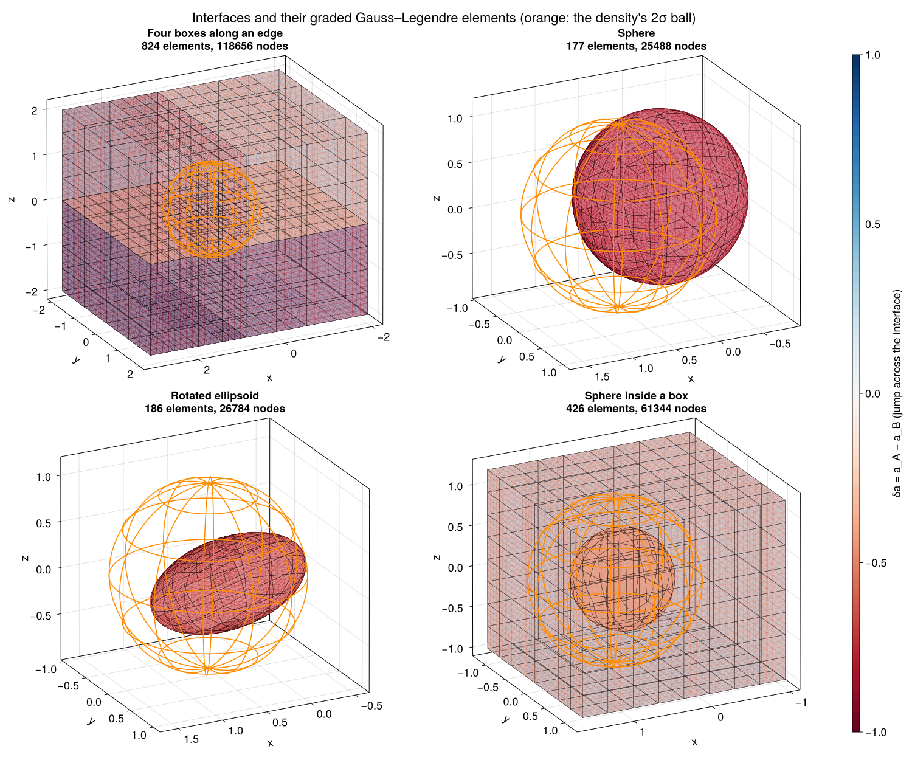
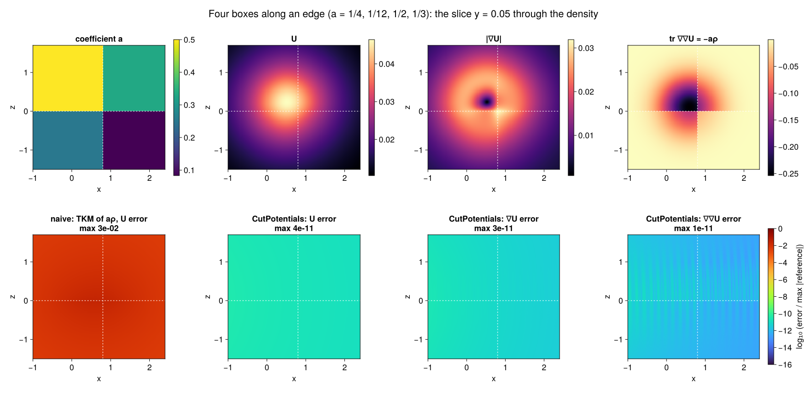
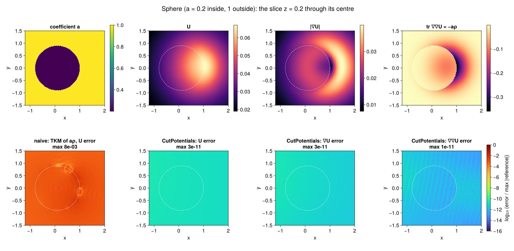

# Examples

The figures on this page come from `docs/figures/make_figures.jl`, which uses the same density and the same
independent references as the tests.

- **Density.** A Gaussian with ``\sigma = 0.5``, centred at ``(0.6, 0.05, 0.1)``. It is sampled on a skewed,
  anisotropic lattice with spacing about ``0.1``, and evaluated with `SmoothField(src; tol = 1e-12)`.
- **References.** Heat-kernel formulas for the Gaussian truncated to a box (products of erf differences) or to a
  ball (a noncentral-``\chi`` formula), differentiated with ForwardDiff.
- **Errors.** Each error is pointwise, divided by the largest reference value on the plot, as in the
  [accuracy tables](accuracy.md).

## Geometries

```julia
itf = box_interfaces(boxes, a, a0)       # boxes: shared faces merged
itf = [sphere_interface(c, R, a_in - a_out)]
itf = [ellipsoid_interface(c, semiaxes, a_in - a_out; R = rotation)]
itf = vcat(box_interfaces([box], [a_box], a0),     # nested regions
           [sphere_interface(c, R, a_sph - a_box)])
sq  = SurfaceQuadrature(itf; support = density_support(src), L0 = 0.5)
```

Every interface is split into SCTL Gauss–Legendre elements, which are refined toward the density's support. Elements
far from the density stay large, so most nodes sit where the integrands vary.

- **Boxes.** For four boxes meeting along an edge, the faces shared by two boxes are stored once, with
  ``\delta a = a_A - a_B``.
- **Nested regions.** The sphere inside a box carries the jump between the box and the sphere.



## Four boxes along an edge

The coefficients are ``a = 1/4, 1/12, 1/2, 1/3`` in the four boxes and ``a_0 = 1`` outside. The slice ``y = 0.05``
passes through the density, the shared faces ``z = 0`` and ``x = 0.8`` (dashed), and their common edge.

```julia
boxes = [((-2.0, -2.0, -2.0), (0.8, 2.0, 0.0)), ((0.8, -2.0, -2.0), (3.0, 2.0, 0.0)),
         ((-2.0, -2.0, 0.0), (0.8, 2.0, 2.0)), ((0.8, -2.0, 0.0), (3.0, 2.0, 2.0))]
itf   = box_interfaces(boxes, [1/4, 1/12, 1/2, 1/3], 1.0)
sq    = SurfaceQuadrature(itf; support = density_support(src), L0 = 0.5)
field = SmoothField(src; tol = 1e-12)
r     = evaluate(CutPlan(sq, targets; a0 = 1.0, hess = true), field)
```

**What the panels show:**
- **Top row.** The coefficient, ``U``, ``|\nabla U|`` and the Laplacian ``\operatorname{tr} \nabla\nabla U``, which
  equals ``-a\rho`` and jumps with ``a``.
- **Bottom row, first panel.** The naive approach: the same smooth-field evaluator (TKM) applied directly to the
  screened samples ``a\rho``. It sees the jumps of ``a\rho``, and its error is ``10^{-2}``.
- **Bottom row, other panels.** CutPotentials' errors in ``U``, ``\nabla U`` and ``\nabla\nabla U``. They are
  about ``10^{-11}`` everywhere: the TKM accuracy of the smooth field, with no trace of the interfaces.



## Sphere

A ball of radius ``0.9`` centred at ``(0.1, 0, 0.2)``, with ``a = 0.2`` inside and ``1`` outside, shown on the slice
``z = 0.2`` through its centre. The density straddles the curved interface. Again the naive evaluation is off by
``10^{-2}`` to ``10^{-3}``, while all three CutPotentials fields stay at the smooth-field accuracy.



## Approaching an interface

Targets approach a face and an edge of one box, ``a = 1/4`` inside and ``1`` outside, from ``d = 10^{-1}`` down to
``d = 10^{-14}``. They come from both sides; circles mark the outside, crosses the inside, and on the face the two
coincide.

- **No snapping.** There is no snapping and no special treatment of nearby targets: the near-singular and singular
  surface integrals are handled by SCTL's corrections, and the double layers have densities that vanish at the
  target.
- **Solid lines.** With the TKM field the error is flat, at the smooth field's ``10^{-11}``.
- **Dotted lines.** With the exact smooth fields (`ExactField` in the tests), only the surface part remains. It
  stays at ``10^{-14}`` at every distance, even at an edge.


