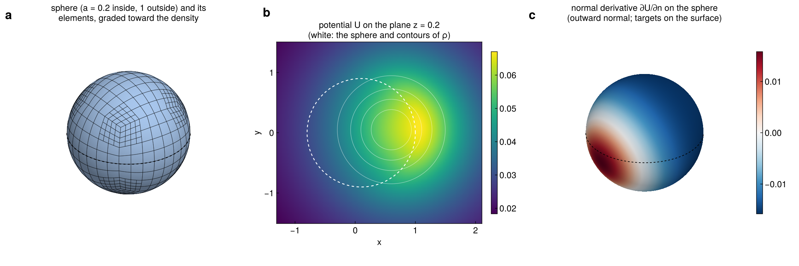
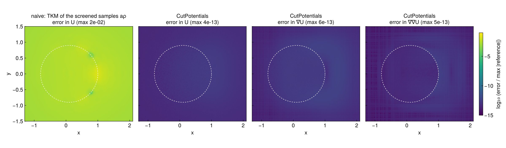
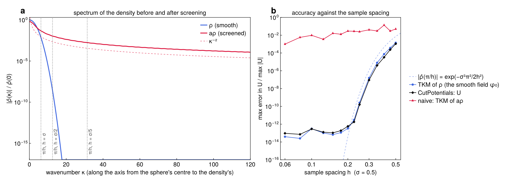
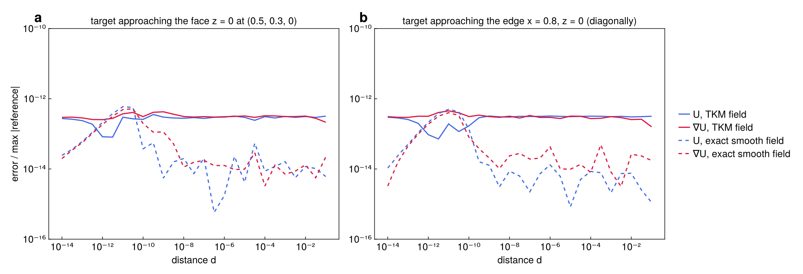

# Examples

The figures on this page come from `docs/figures/make_figures.jl`. The references are independent of the method:
heat-kernel formulas for a Gaussian truncated to a ball or a box (as in the tests), differentiated with ForwardDiff.

## A density straddling a sphere

The density is a Gaussian, ``\sigma = 0.5``, centred at ``(0.6, 0.05, 0.1)``. It is sampled on a cubic lattice of
spacing ``h = 0.1`` covering ``\pm 8\sigma``. The coefficient is ``a = 0.2`` inside the ball of radius ``0.9``
about ``(0.1, 0, 0.2)``, and ``a_0 = 1`` outside, so the density straddles the interface.

```julia
src   = VolumeSource(x -> ρ(x), origin, 0.1 * I(3), (n, n, n))
field = SmoothField(src; tol = 1e-12)
itf   = [sphere_interface((0.1, 0.0, 0.2), 0.9, 0.2 - 1.0)]   # δa = 0.2 − 1
sq    = SurfaceQuadrature(itf; support = density_support(src), L0 = 0.5)
r     = evaluate(CutPlan(sq, targets; a0 = 1.0, grad = true), field)
```

- **a.** The sphere's Gauss–Legendre elements, refined toward the density on the ``+x`` side.
- **b.** ``U`` on the plane ``z = 0.2``. The coefficient is small inside the sphere, so the potential peaks just
  outside it, on the side where most of the unscreened density lies.
- **c.** The normal derivative ``\partial U / \partial n`` at targets exactly on the sphere. ``U`` and
  ``\nabla U`` are continuous across the interface, so no side has to be chosen.



## Accuracy, against the naive approach

The naive approach evaluates the screened samples ``a\rho`` directly with the same smooth-field evaluator (TKM).
Its error is ``10^{-2}``. CutPotentials' errors in ``U``, ``\nabla U`` and ``\nabla\nabla U`` are
``4 \times 10^{-13}``, ``6 \times 10^{-13}`` and ``5 \times 10^{-13}``. They are uniform across the interface; the
dashed circle marks it.



## When the smooth-field evaluation fails

Everything CutPotentials computes in the volume is a TKM evaluation of the smooth ``\rho``. Its accuracy is set
by how much of ``\hat\rho`` the samples miss, and not by `tol`:

- **Panel a: before and after screening.** Along the axis through the sphere's centre and the density's,
  ``\hat\rho`` is a Gaussian. It drops below ``10^{-16}`` by ``\kappa \approx 18``. The screened ``a\rho`` jumps
  across the sphere, and its spectrum decays only like ``\kappa^{-2}``. The samples resolve wavenumbers up to
  ``\pi/h``, the dotted lines, and what lies beyond is lost.
- **Panel b: error against the spacing.**
  - **Naive TKM of ``a\rho``.** At ``\pi/h`` the screened spectrum is still ``10^{-2}`` to ``10^{-3}``. Its error
    stays there at every spacing.
  - **TKM of ``\rho`` and CutPotentials' ``U``.** Both track ``|\hat\rho(\pi/h)| =
    e^{-\sigma^2\pi^2/2h^2}``. They reach the ``10^{-13}`` floor once ``h \lesssim \sigma/2.5``.
  - **Coarse samples.** At ``h = \sigma/2`` the error is ``10^{-10}``. At ``h = \sigma`` it is ``10^{-3}``, the
    same as the naive error.

The surface corrections cannot repair a density that its samples do not resolve. They remove only the error that
screening adds.

**The sample box.** The density must also decay inside the sample box: the samples omit its tail beyond it. With
a box of ``\pm 6\sigma`` the smooth field's error is ``6 \times 10^{-10}``, with ``\pm 7\sigma`` it is
``6 \times 10^{-13}``, and with ``\pm 8\sigma`` about ``10^{-13}``. The tests' skewed lattice cuts the Gaussian
at about ``7\sigma`` in one corner, which is why they measure ``10^{-11}``.



## Targets approaching an interface

Here one box has ``a = 1/4`` inside and ``1`` outside. A target approaches a face (a) and an edge (b) of it, from
``d = 10^{-1}`` down to ``10^{-14}``.

- **No special treatment.** There is no snapping and no special case for nearby targets. SCTL's corrections handle
  the near-singular and singular surface integrals. The double layers have densities that vanish at the target.
- **Solid lines.** With the TKM field the error is flat, at the smooth field's ``3 \times 10^{-13}``.
- **Dashed lines.** With the exact smooth fields only the surface part remains. It stays at ``10^{-14}`` to
  ``10^{-13}`` at every distance, even at the edge.


