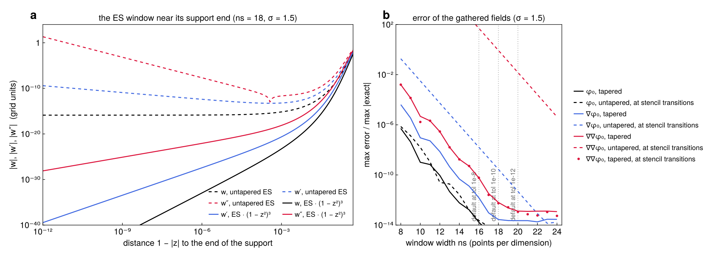

# Derivatives through the NUFFT

Inside the padded sample box, [`SmoothField`](@ref) represents ``\varphi_0 = N[\rho]`` by its truncated-kernel
Fourier coefficients. For modes ``|k| \le k_{\max} = \pi/h``,

```math
\varphi_0(y) = C \sum_{k} \hat c_k\, e^{i k\cdot(y - y_c)}, \qquad
\hat c_k = 2\left(\frac{\sin(L|k|/2)}{|k|}\right)^2 \hat\rho_k ,
```

where ``\hat\rho_k`` comes from one type-1 NUFFT (FINUFFT) of the samples. The surface corrections need
``\varphi_0``, ``\nabla\varphi_0`` and ``\nabla\nabla\varphi_0`` at every surface node and target: 10 fields.

## Two ways to get the derivatives

- **Spectral.** Multiply ``\hat c_k`` by ``ik_a`` and ``-k_a k_b``. That is 10 coefficient arrays and 10 type-2
  NUFFTs.
- **Through the interpolant** (used here). Deconvolve ``\hat c_k`` once by the window's Fourier factors, and
  transform onto one real fine grid ``g`` of ``\sigma \times`` the mode count per axis (``\sigma = 1.5``). Each
  value is then a tensor-product sum over the ``n_s^3`` grid points around the target. With ``t_d`` the offset in
  grid units and ``\alpha_d`` the grid-to-physical scale,

  ```math
  \begin{aligned}
  \varphi_0 &\approx C \sum_\ell g_\ell\, w(t_1)\, w(t_2)\, w(t_3), \\
  \partial_1 \varphi_0 &\approx -C\alpha_1 \sum_\ell g_\ell\, w'(t_1)\, w(t_2)\, w(t_3), \\
  \partial_1 \partial_2 \varphi_0 &\approx C\alpha_1\alpha_2 \sum_\ell g_\ell\, w'(t_1)\, w'(t_2)\, w(t_3), \qquad
  \partial_1^2 \varphi_0 \approx C\alpha_1^2 \sum_\ell g_\ell\, w''(t_1)\, w(t_2)\, w(t_3),
  \end{aligned}
  ```

  and likewise for the other directions.

These are the exact derivatives of the NUFFT interpolant. They are what automatic differentiation of the type-2
interpolation with respect to the target coordinates would return, computed analytically and fused into one pass
that reads each grid value once. The derivatives are therefore only as good as ``w'`` and ``w''``, which constrains
the window.

## The window

```math
w(z) = e^{\beta\left(\sqrt{1 - z^2} - 1\right)}\, (1 - z^2)^3, \qquad z = \frac{t}{n_s/2} \in [-1, 1],
\qquad \beta = 0.97\,\pi\, n_s \left(1 - \frac{1}{2\sigma}\right).
```

- **Shape.** This is FINUFFT's exponential of semicircle (ES), with its shape parameter ``\beta``, times a taper
  ``(1 - z^2)^3``.
- **Evaluation.** ``w``, ``w'`` and ``w''`` are evaluated analytically.
- **Fourier factors.** They are computed by Gauss–Legendre quadrature of the same window, so the deconvolution is
  consistent with the gather.

**Why the taper.** The plain ES window is cut off at ``|z| = 1``, where ``\sqrt{1 - z^2}`` has infinite slope.
Near the end of the support, ``w' \propto (1 - |z|)^{-1/2}`` and ``w'' \propto (1 - |z|)^{-3/2}``, both times
``e^{-\beta}`` (panel a). For most targets the factor ``e^{-\beta} \approx 10^{-16}`` hides this. But a target
whose stencil has a point just inside the support end, at a *stencil transition*, picks up the singular ``w''``.

- **Without the taper.** At stencil transitions the Hessian error is ``O(1)`` at the default width (dashed red,
  panel b), and still ``10^{-5}`` at 24 points.
- **Where the targets fall.** Random targets rarely land within ``10^{-9}`` of a transition. A large target set,
  or grid-aligned nodes such as those on box faces, does.
- **With the taper.** The taper makes ``w``, ``w'`` and ``w''`` vanish continuously at ``|z| = 1``. The error at
  transitions (dots) is then the same as at random targets.

A fitted piecewise-polynomial window, which FINUFFT uses for speed, is no alternative. Each derivative of the fit
loses about a factor ``N^2`` (Markov's inequality), and the Hessian stalls near ``10^{-9}``.

## How many points

``n_s`` follows FINUFFT's ES rule for value accuracy, ``n_s = \lceil \ln(1/\varepsilon) / (\pi\sqrt{1 - 1/\sigma})
\rceil``. It is applied at the tighter ``\varepsilon = 10^{-4}\,\mathrm{tol}`` (`window_tol`), because the derivatives
need more points than the values. Panel b shows the error of each gathered field against ``n_s``: a well-resolved
Gaussian, the NUFFT at ``10^{-14}``, and errors relative to each field's maximum. The smallest width with error
``\le \mathrm{tol}``, at random targets and at transitions:

| `tol` | ``\varphi_0`` | ``\nabla\varphi_0`` | ``\nabla\nabla\varphi_0`` | FINUFFT, values only | default ``n_s`` |
|---|---|---|---|---|---|
| ``10^{-8}`` | 10 | 12 | 14 | 11 | 16 |
| ``10^{-10}`` | 13 | 14 | 16 | 13 | 18 |
| ``10^{-12}`` | 14 | 16 | 18 | 16 | 20 |

- **Each derivative costs about two points.** Values need about FINUFFT's width. The Hessian needs about four
  points more.
- **The default keeps two points of margin** over the Hessian's need, because the fields of a real campaign are
  less smooth than one Gaussian.
- **Oversampling.** The rule is evaluated at ``\min(\sigma, 1.5)``. FINUFFT's law narrows the window as ``\sigma``
  grows, which suits the values, but the widths the derivatives need stop falling near ``\sigma = 1.5``: aliased
  modes are amplified by ``|k + p\,n_f|^d`` in the ``d``-th derivative. At `window_sigma = 2` the value law would give
  13 / 15 / 17 points, and at `tol` ``10^{-10}`` the Hessian's window error would be ``1.4 \cdot 10^{-10}``. A
  larger ``\sigma`` therefore only enlarges the grid.
- **Override it** with `SmoothField(src; window_ns = 16)`. Widths beyond 20 gain nothing: at about ``10^{-13}``
  the error is set by the type-1 NUFFT and the samples.



## Cost

- **Per target.** ``n_s^3`` grid reads (5832 at ``n_s = 18``) and three running sums per grid line give all 10
  fields at once. 100,000 targets take about 0.2 s at 16 threads.
- **Memory.** The gather is memory-bound, so a narrower window helps less than ``n_s^3`` suggests.
- **The grid.** One real array of ``(\sigma m)^3`` doubles, for ``m`` modes per axis. It is built once per density
  with one FFT.

**Alternatives that were measured** (in DielectricBIE.jl, from which this evaluator comes):
- **A prolate (PSWF) window** with the same taper saves about one point. Its Legendre-series evaluation costs more
  than that saves.
- **A larger shape parameter** (``1.1\beta``) saves about two points at equal accuracy.
- **``\sigma = 1.25``** halves the grid's memory, for one more point.
